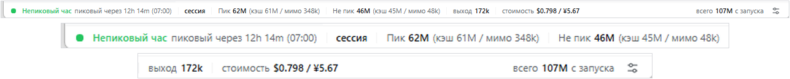

# DSH token status

A status bar for the **DeepSeek Harness Web GUI** that answers two questions at a glance: how much
this conversation has cost so far, and whether the expensive tariff is in force right now. Each
model has its own price plan, so the bar charges a session by the plan of the model it is running
and names that model.



[English](#english) · [Русский](#русский)

---

## English

### What it shows

The bar spans the whole width at the bottom of the window:

| Part | Meaning |
|---|---|
| Dot and tariff label | The tariff in force now — red `Peak`, green `Off-peak` — plus the local clock time when it flips |
| `session` / `all` | Scope: the open conversation, or every session in the process when no conversation is open |
| `model` | The model the counters and the cost belong to — `deepseek-flash`, `deepseek-v4-pro`, or `all models` for the process total |
| `Peak` / `Off-peak` | Tokens billed under each tariff, with prompt-cache hits and misses in brackets |
| `output` | Output tokens across both tariffs |
| `cost` | Estimated charge in USD and CNY, priced by the plan of the model shown |
| `total … since launch` | Every billed token in this Harness process |
| Gear | Opens the settings panel |

### Requirements

* DeepSeek Harness with the Web GUI (the `dsh-web-app` bundle; the shipped `desktop` and `web`
  profiles have it).
* Nothing else: no dependencies and no build step. The plugin reads the usage the Harness already
  records in the session log and never sends it anywhere; its only network request is the price
  page it loads when you press **Autofill** in the settings panel.

### Install

1. Get the files: `git clone https://github.com/Nosferatus83/DSH-token-status.git`, or use
   **Code → Download ZIP** and unpack it.
2. In DSH open the sidebar **Plugins** panel and choose **Add plugin** (Russian UI:
   **Плагины → Добавить плагин**).
3. Select the folder that contains `package.json` — the root of this repository.
4. Wait for the bundle row to appear as enabled. The bar shows up at the bottom of the window; if
   it does not, reload the page.

The bundle links to the folder you selected, so `git pull` there plus a DSH restart picks up a
newer version, and removing the bundle in **Plugins** uninstalls it. If your DSH exposes the
`plugin_manager` agent tool, installing works the same way: `install_bundle` with this folder as
the target.

### Language

The gear at the right end of the bar opens the settings panel, whose first field is **Language**:

| Choice | Effect |
|---|---|
| `Match the interface` (default) | Follows the Harness interface language |
| `English` | Pins the bar to English |
| `Русский` | Pins the bar to Russian |

The choice is saved as this plugin row's config, so it survives restarts, and it also applies
immediately instead of waiting for the row to restart.

### Settings

The same panel edits the constants the estimate is computed from. Each model carries its own
plan, and the panel shows one model at a time so the fields stay short:

| Field | Meaning |
|---|---|
| `Model` | The model whose plan the price rows below belong to. Switching it swaps the rows; nothing is saved yet |
| `Save prices` | Writes the edited plans to the profile right away and leaves the panel open |
| `Autofill` | Loads the published DeepSeek prices for every model and puts them in the rows as a draft. Press **Save prices** to keep them |
| `Peak` / `Off-peak` rows | Price per 1,000,000 tokens for a cache hit, a cache miss, and output |
| `USD→CNY` | Rate used for the second currency |
| `Peak hours (UTC)` | One or more intervals billed at the full price; everything outside them is off-peak. **Add interval** adds a row |
| `Scope` | Whether the bar counts the open conversation or the whole process |

**Save** writes the values through the profile's config editor, so they persist and stay visible
in the profile patch. **Defaults** refills the form with the shipped DeepSeek prices without
saving. Editing a config field restarts the row: the counters are rebuilt from the sessions that
are still live and repriced under the new constants.

**Autofill** asks the Host half to load the price list, and the Host tries three sources in order:
the JSON endpoint `https://api.deepseek.com/pricing` (which answers only with an API key, so the
key from `DEEPSEEK_API_KEY` is sent when the environment has one), then the documentation page as
Markdown, then the same page as HTML. The result is a draft for both models — it is never written
without you pressing a save button. DeepSeek does not document a public pricing API, so in practice
the documentation page is what answers.

```yaml
- id: token-status
  name: 'dsh-token-status'
  config:
    language: auto            # 'auto' (follow the Harness), 'en' or 'ru'
    scope: session            # 'session' (default) or 'process'
    cnyPerUsd: 7.1            # rate used to derive the second currency
    defaultModel: deepseek-flash   # model assumed when the log names none
    models:                   # one plan per model, USD per 1,000,000 tokens
      deepseek-flash:
        peak:    { cacheHit: 0.006, cacheMiss: 0.3,  output: 1.2 }
        offPeak: { cacheHit: 0.003, cacheMiss: 0.15, output: 0.6 }
      deepseek-v4-pro:
        peak:    { cacheHit: 0.044, cacheMiss: 1.32, output: 3.96 }
        offPeak: { cacheHit: 0.022, cacheMiss: 0.66, output: 1.98 }
    peakWindows:              # UTC, intervals billed at the full price; the rest is off-peak
      - { from: '01:00', to: '04:00' }
      - { from: '06:00', to: '10:00' }
```

A config written before plans were per model carries one `pricing` list; it is read as the plan of
`defaultModel`, and the other model keeps its shipped prices.

### Tariff model

Each usage report is billed by the tariff in force when its step **started**, so a request that
runs across the boundary lands in the bucket it was charged in. A cache write is priced as a
missed prompt token. The cost of a model is computed from that model's own plan: a session that
switches model mid-conversation keeps a separate pair of buckets per model, and the bar follows
the model in force as soon as the next request announces it.

The plan is described by its **peak** intervals, so a plan with two expensive windows a day is
two `peakWindows` entries. A config written the other way round (with `offPeakWindows`) is still
read once and complemented into peak intervals, and saving from the form rewrites it in the new
shape.

### How it works

* The Host half folds `assistant/message` usage from the durable session log into two tariff
  buckets per session and per model, backfills sessions that were already live, then follows
  `session/event`. The model comes from the request header of the step, so a switch is picked up
  as soon as the next request starts.
* It serves one JSON snapshot on the prefix route `/token-status`. Every request passes
  `ctx.connection.requestRejection`, so the Host/Origin fence and the browser credential decide
  who may call it. `GET /token-status/snapshot` reads; `POST /token-status/settings` validates the
  form and persists it through `ctx.configEditor.edit`; `POST /token-status/pricing/refresh` loads
  the published price list and returns it as a draft.
* The browser half registers into the root-scoped `shell.bottom` slot, polls the snapshot every 3
  seconds, and ticks its own clock every second so the tariff dot flips exactly on the boundary.
  Styling uses `--dsw-alias-*` theme tokens only, so it follows the light and dark themes.

### Limitations

* Counters start at zero when the Harness process starts; nothing is persisted across restarts.
* The scope is the open conversation or the whole process — not a chosen subset of sessions.
* The peak windows apply every day. DeepSeek excludes weekends and Chinese public holidays from
  its peak hours and the bar cannot express that, so weekend spend may be priced at the peak rate.
* The shipped prices are the ones DeepSeek publishes for `deepseek-flash` and `deepseek-v4-pro`;
  another plan needs its own `models` and `peakWindows`.
* The bar is a Web GUI surface; other DSH surfaces have no bottom slot to render into.

---

## Русский

### Что показывает

Полоса во всю ширину внизу окна:

| Часть | Значение |
|---|---|
| Кружок и название тарифа | Действующий тариф — красный `Пиковый час`, зелёный `Непиковый час` — и местное время, когда он сменится |
| `сессия` / `всё` | Что считается: открытый диалог или все сессии процесса, когда диалог не открыт |
| `модель` | Модель, к которой относятся счётчики и стоимость: `deepseek-flash`, `deepseek-v4-pro` или `все модели` для всего процесса |
| `Пик` / `Не пик` | Токены по каждому тарифу, в скобках — попадания в кэш и промахи |
| `выход` | Выходные токены по обоим тарифам |
| `стоимость` | Оценка в USD и CNY по тарифу показанной модели |
| `всего … с запуска` | Все списанные токены в этом процессе Harness |
| Шестерёнка | Открывает панель настроек |

### Требования

* DeepSeek Harness с веб-интерфейсом (bundle `dsh-web-app`; он есть в штатных профилях `desktop`
  и `web`).
* Больше ничего: ни зависимостей, ни сборки. Плагин читает расход, который Harness и так
  записывает в журнал сессий, и никуда его не отправляет; единственный сетевой запрос — страница
  прайса, которую он загружает по кнопке **Автозаполнить** в настройках.

### Установка

1. Получите файлы: `git clone https://github.com/Nosferatus83/DSH-token-status.git` или
   **Code → Download ZIP** с распаковкой.
2. В DSH откройте боковую панель **Плагины** и выберите **Добавить плагин**
   (в английском интерфейсе — **Plugins → Add plugin**).
3. Укажите папку с файлом `package.json` — корень этого репозитория.
4. Дождитесь, пока строка bundle станет включённой. Полоса появится внизу окна; если её нет —
   обновите страницу.

Bundle ссылается на выбранную папку, поэтому `git pull` в ней и перезапуск DSH подхватывают
новую версию, а удаление bundle в **Плагинах** удаляет плагин. Если в вашем DSH доступен
агентский инструмент `plugin_manager`, установка та же: `install_bundle` с этой папкой в
качестве цели.

### Язык

Шестерёнка в правом конце полосы открывает панель настроек, первое поле в ней — **Язык**:

| Вариант | Действие |
|---|---|
| `Как в интерфейсе` (по умолчанию) | Следует языку интерфейса Harness |
| `English` | Фиксирует английский |
| `Русский` | Фиксирует русский |

Выбор сохраняется в конфигурации строки плагина и переживает перезапуск, а применяется сразу,
не дожидаясь перезапуска строки.

### Настройки

Та же панель задаёт константы, по которым считается оценка. У каждой модели свой план, и панель
показывает одну модель за раз, чтобы полей не становилось больше:

| Поле | Значение |
|---|---|
| `Модель` | Модель, к которой относятся строки цен ниже. Переключение меняет строки и ничего не сохраняет |
| `Записать цены` | Сразу записывает отредактированные планы в профиль и оставляет панель открытой |
| `Автозаполнить` | Загружает опубликованный прайс DeepSeek для всех моделей в виде черновика. Чтобы его сохранить, нажмите **Записать цены** |
| Строки `Пик` / `Не пик` | Цена за 1 000 000 токенов: попадание в кэш, промах, выход |
| `USD→CNY` | Курс для второй валюты |
| `Пиковые часы (UTC)` | Один или несколько интервалов по полному тарифу; всё остальное время — непиковое. **Добавить интервал** добавляет строку |
| `Счёт` | Считать открытый диалог или весь процесс |

**Сохранить** записывает значения через редактор конфигурации профиля, поэтому они сохраняются и
остаются видны в патче профиля. **По умолчанию** заполняет форму штатными ценами DeepSeek без
сохранения. Изменение поля конфигурации перезапускает строку: счётчики собираются заново из
живых сессий и пересчитываются по новым константам.

**Автозаполнить** просит Host-часть загрузить прайс, и та пробует три источника по порядку: JSON
`https://api.deepseek.com/pricing` (он отвечает только с ключом API, поэтому ключ из
`DEEPSEEK_API_KEY` подставляется, если он есть в окружении), затем страницу документации в виде
Markdown, затем ту же страницу как HTML. Результат — черновик для обеих моделей; без нажатия
кнопки сохранения он никуда не записывается. Публичного API цен DeepSeek не документирует,
поэтому на практике отвечает страница документации.

```yaml
- id: token-status
  name: 'dsh-token-status'
  config:
    language: auto            # 'auto' (как в Harness), 'en' или 'ru'
    scope: session            # 'session' (по умолчанию) или 'process'
    cnyPerUsd: 7.1            # курс для второй валюты
    defaultModel: deepseek-flash   # модель, если в журнале она не названа
    models:                   # свой план на каждую модель, USD за 1 000 000 токенов
      deepseek-flash:
        peak:    { cacheHit: 0.006, cacheMiss: 0.3,  output: 1.2 }
        offPeak: { cacheHit: 0.003, cacheMiss: 0.15, output: 0.6 }
      deepseek-v4-pro:
        peak:    { cacheHit: 0.044, cacheMiss: 1.32, output: 3.96 }
        offPeak: { cacheHit: 0.022, cacheMiss: 0.66, output: 1.98 }
    peakWindows:              # UTC, интервалы по полному тарифу; остальное — непиковое
      - { from: '01:00', to: '04:00' }
      - { from: '06:00', to: '10:00' }
```

Конфигурация, записанная до появления планов по моделям, несёт один список `pricing`: он читается
как план `defaultModel`, а вторая модель остаётся со штатными ценами.

### Модель тарифа

Каждый отчёт о расходе относится к тарифу, действовавшему в момент **начала** шага, поэтому запрос
через границу попадает в тот тариф, по которому списан. Запись в кэш оценивается как промах.
Стоимость модели считается по её собственному плану: сессия, сменившая модель посреди диалога,
хранит отдельную пару счётчиков на каждую модель, а полоса переключается на действующую модель,
как только об этом сообщает следующий запрос.

План описывается **пиковыми** интервалами: план с двумя дорогими окнами в сутки — это две записи
`peakWindows`. Конфигурация, записанная наоборот (через `offPeakWindows`), один раз читается и
дополняется до пиковых интервалов, а сохранение из формы переписывает её в новом виде.

### Как это устроено

* Host-часть складывает расход `assistant/message` из журнала сессий в два тарифных счётчика на
  сессию и на модель, досчитывает уже живые сессии и далее следит за `session/event`. Модель
  берётся из заголовка запроса шага, поэтому смена модели видна, как только начнётся следующий
  запрос.
* Она отдаёт один JSON-снимок по префиксному маршруту `/token-status`. Каждый запрос проходит
  через `ctx.connection.requestRejection`, поэтому доступ решают Host/Origin-защита и браузерные
  учётные данные. `GET /token-status/snapshot` читает; `POST /token-status/settings` проверяет
  форму и сохраняет её через `ctx.configEditor.edit`; `POST /token-status/pricing/refresh`
  загружает опубликованный прайс и возвращает его черновиком.
* Browser-часть регистрируется в корневом слоте `shell.bottom`, опрашивает снимок раз в 3 секунды
  и раз в секунду пересчитывает свои часы, чтобы кружок переключался ровно на границе. Оформление
  использует только токены темы `--dsw-alias-*`, поэтому работает в светлой и тёмной теме.

### Ограничения

* Счётчики начинаются с нуля при старте процесса Harness; между перезапусками ничего не
  сохраняется.
* Область — открытый диалог или весь процесс, но не выбранный набор сессий.
* Пиковые интервалы действуют каждый день. DeepSeek исключает из пиковых часов выходные и
  китайские праздники, а полоса это выразить не может, поэтому расход в выходные может считаться
  по пиковому тарифу.
* Штатные цены — опубликованные DeepSeek для `deepseek-flash` и `deepseek-v4-pro`; для другого
  плана нужны свои `models` и `peakWindows`.
* Полоса — поверхность веб-интерфейса; в других интерфейсах DSH нет нижнего слота для неё.

## License

MIT — see [LICENSE](LICENSE).
